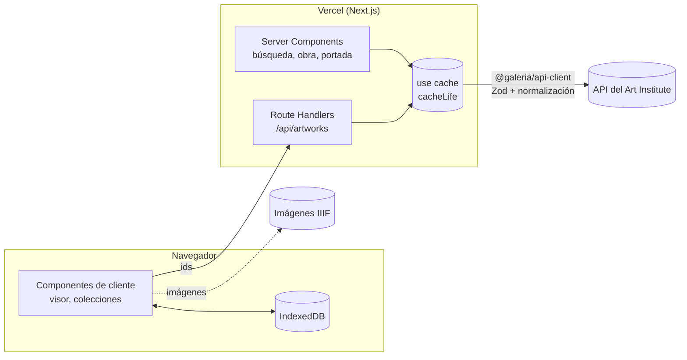

# Galería

Explorador de la colección pública del [Art Institute of Chicago](https://api.artic.edu/docs): busca obras, míralas en alta resolución con un visor de zoom accesible y guárdalas en colecciones que se comparten con un enlace. Hecho con **Next.js 16, React 19 y TypeScript**, sin backend propio.

> **Demo:** _(añade aquí la URL de Vercel)_ · **Storybook:** _(añade aquí la URL)_

## Qué demuestra

| Área               | Cómo                                                                                                      |
| ------------------ | --------------------------------------------------------------------------------------------------------- |
| Arquitectura       | Monorepo pnpm + Turborepo; capas `app → features → shared` impuestas por ESLint; archivos de ≤ 150 líneas |
| Datos              | Contrato con Zod, tipos propios y BFF con Route Handlers; el navegador nunca llama a la API del museo     |
| Renderizado        | ISR con Cache Components en obras, SSR en búsqueda (funciona sin JavaScript), streaming donde aporta      |
| Design system      | Tokens en Tailwind v4, componentes en `packages/ui`, Storybook con addon de accesibilidad                 |
| Accesibilidad      | WCAG 2.2 AA: axe en tests de componentes, Storybook y e2e; visor de zoom operable con teclado             |
| Rendimiento        | IIIF a ancho exacto, `srcset`, CLS 0, Lighthouse CI con presupuestos                                      |
| Estado sin backend | Colecciones en IndexedDB detrás de un repositorio, sincronizadas entre pestañas y compartibles por URL    |
| Calidad            | 200 tests unitarios y de integración + 20 e2e, cobertura mínima del 80 %, CI en cada PR                   |
| Observabilidad     | Sentry con source maps, contexto sin datos personales e incidente simulado documentado                    |

## Arquitectura



```text
apps/web/              App Next.js: rutas (app/), features/ y shared/
packages/ui/           Design system: tokens, componentes, Storybook
packages/api-client/   Contrato tipado con la API del museo (sin React)
packages/config/       TypeScript, ESLint y Prettier compartidos
docs/                  Arquitectura, ADRs, rendimiento, observabilidad, incidentes, planes
```

Detalle y reglas: [`docs/ARCHITECTURE.md`](docs/ARCHITECTURE.md).

## Cómo empezar

Requisitos: Node.js 22 y pnpm 12 (`npm install -g pnpm`).

```bash
pnpm install
pnpm dev                                   # http://localhost:3000 (API real del museo)
```

Sin conexión, o para tener datos deterministas:

```bash
pnpm --filter @galeria/web mock:api        # API simulada en http://localhost:4010
AIC_API_BASE_URL=http://localhost:4010/api/v1 pnpm dev
```

Variables de entorno: [`apps/web/.env.example`](apps/web/.env.example).

## Scripts

| Comando                                              | Qué hace                                                                  |
| ---------------------------------------------------- | ------------------------------------------------------------------------- |
| `pnpm verify`                                        | Formato, lint, tipos y tests con umbral de cobertura (lo mismo que el CI) |
| `pnpm build`                                         | Compila todos los paquetes                                                |
| `pnpm --filter @galeria/web test:e2e`                | Playwright + axe (escritorio y móvil) contra la API simulada              |
| `pnpm --filter @galeria/web perf:measure <url>`      | Lighthouse móvil, mediana de 3 ejecuciones                                |
| `pnpm --filter @galeria/web perf:ci`                 | Lighthouse CI con presupuestos                                            |
| `pnpm --filter @galeria/web analyze`                 | Analizador de bundle de Turbopack                                         |
| `pnpm --filter @galeria/ui storybook`                | Storybook en http://localhost:6006                                        |
| `pnpm --filter @galeria/api-client fixtures:capture` | Guarda respuestas reales de la API para compararlas                       |

## Estrategia de pruebas

| Nivel       | Herramienta                                     | Qué verifica                                                                                  | Cuántas                   |
| ----------- | ----------------------------------------------- | --------------------------------------------------------------------------------------------- | ------------------------- |
| Unitarias   | Vitest                                          | Contrato y normalización, filtros de la URL, reducer del zoom, reglas de colecciones          | Muchas, rápidas           |
| Integración | Vitest + Testing Library + MSW + fake-indexeddb | Páginas con la API simulada; servicio de colecciones contra IndexedDB y memoria               | Bastantes                 |
| Componentes | Testing Library + axe                           | Lo que el usuario ve y hace, y accesibilidad                                                  | Una por componente        |
| End-to-end  | Playwright + axe                                | Buscar y abrir, visor con teclado, colecciones compartidas, todo con teclado, búsqueda sin JS | 4 flujos × 2 dispositivos |

Por qué no todo es e2e: los e2e son lentos y frágiles. Cubren los flujos críticos de punta a punta; las reglas y los casos límite se prueban más abajo, donde fallan rápido y señalan la causa exacta.

## Rendimiento

Peso de imágenes por página (Lighthouse móvil, mediana de 5 ejecuciones):

| Página   | Antes   | Después         |
| -------- | ------- | --------------- |
| Portada  | 5949 KB | 1498 KB (−75 %) |
| Búsqueda | 5949 KB | 764 KB (−87 %)  |
| Obra     | 5949 KB | 172 KB (−97 %)  |

CLS 0 en todas las páginas y 177 KB de JavaScript (presupuesto: 200 KB). Método, limitaciones y LCP en [`docs/performance.md`](docs/performance.md).

## Decisiones (ADRs)

1. [Monorepo con pnpm y Turborepo](docs/adr/0001-monorepo-pnpm-turborepo.md)
2. [BFF con Route Handlers y Server Components](docs/adr/0002-bff-con-route-handlers.md)
3. [Contratos con Zod y tipos propios](docs/adr/0003-contratos-con-zod.md)
4. [ISR con Cache Components](docs/adr/0004-isr-con-cache-components.md)
5. [Tailwind v4 con tokens](docs/adr/0005-tailwind-con-tokens.md)
6. [Visor de zoom propio](docs/adr/0006-visor-de-zoom-propio.md)
7. [Colecciones con IndexedDB y enlaces](docs/adr/0007-colecciones-indexeddb-y-url.md)
8. [Búsqueda que funciona sin JavaScript](docs/adr/0008-busqueda-sin-javascript.md)

También: [deuda técnica](TECH_DEBT.md) · [observabilidad](docs/observability.md) · [incidente 001](docs/incidentes/001-cambio-de-contrato-en-busqueda.md) · [estrategia de texto alternativo](docs/alt-text.md) · [cómo contribuir](CONTRIBUTING.md) · [producto](PRODUCT.md) · [diseño](DESIGN.md).

## Despliegue

1. **App:** importa el repositorio en Vercel con **Root Directory = `apps/web`**. Vercel detecta pnpm y Turborepo.
2. **Sentry (opcional):** `NEXT_PUBLIC_SENTRY_DSN`, `SENTRY_ORG`, `SENTRY_PROJECT` y, solo en build, `SENTRY_AUTH_TOKEN`.
3. **Storybook:** segundo proyecto en Vercel con Root Directory `packages/ui`, build `pnpm build-storybook` y salida `storybook-static`.

## Créditos

Datos e imágenes: [Art Institute of Chicago](https://www.artic.edu), solo obras de dominio público. Galería no está afiliada al museo.
