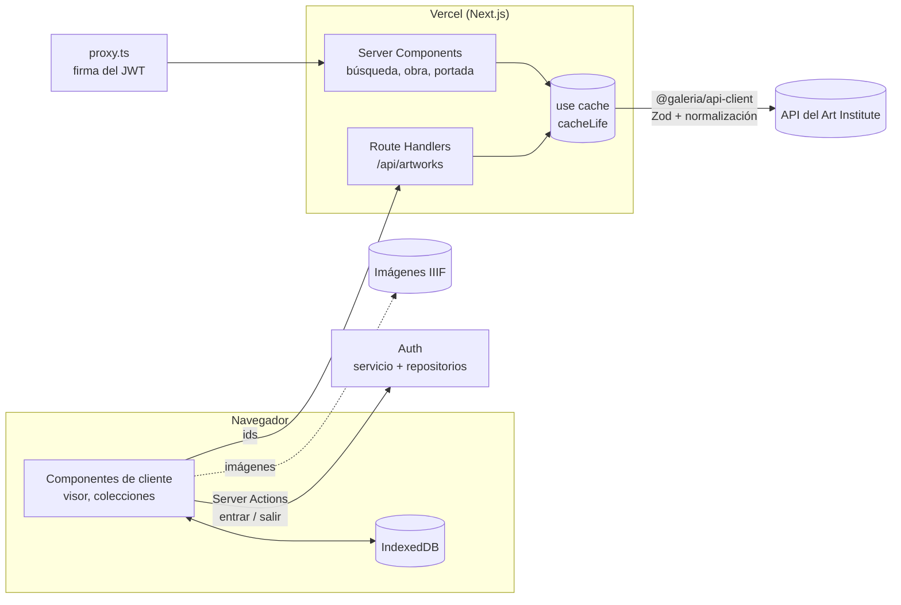

# Galería

Explorador de la colección pública del [Art Institute of Chicago](https://api.artic.edu/docs): busca obras, míralas en alta resolución con un visor de zoom accesible, guárdalas en colecciones que se comparten con un enlace y entra con tu cuenta. Hecho con **Next.js 16, React 19 y TypeScript**, sin backend propio.

La portada es una sala en penumbra: la obra bajo un foco que sigue al puntero y el nombre colgado como un estandarte de fachada, en la tipografía cívica de Chicago. Para probar las cuentas sin registrarte, usa **«Entrar con la cuenta de demostración»** en `/entrar`.

> **Demo:** _(añade aquí la URL de Vercel)_ · **Storybook:** _(añade aquí la URL)_

## Qué demuestra

| Área               | Cómo                                                                                                        |
| ------------------ | ----------------------------------------------------------------------------------------------------------- |
| Arquitectura       | Monorepo pnpm + Turborepo; capas `app → features → shared` impuestas por ESLint; archivos de ≤ 150 líneas   |
| Patrones           | Repositorio, servicio con inyección de dependencias, raíz de composición, DAL, adaptadores y slots          |
| Autenticación      | JWT de acceso (15 min) + refresco rotatorio con detección de reutilización, en cookies `HttpOnly`           |
| Seguridad          | scrypt, límite de intentos, sin enumeración de cuentas, CSP y cabeceras, redirecciones seguras, CSRF        |
| Movimiento         | Un momento orquestado por página, foco que sigue al puntero, scroll-driven y View Transitions, sin libs     |
| Renders            | Cero renders innecesarios: React Compiler, gestos sin pasar por React, verificado con `<Profiler>`          |
| Datos              | Contrato con Zod, tipos propios y BFF con Route Handlers; el navegador nunca llama a la API del museo       |
| Renderizado        | ISR con Cache Components en obras, SSR en búsqueda (funciona sin JavaScript), streaming donde aporta        |
| Design system      | Identidad propia («sala iluminada»), tokens en Tailwind v4, `packages/ui`, Storybook con accesibilidad      |
| Accesibilidad      | WCAG 2.2 AA: axe en tests de componentes, Storybook y e2e; visor de zoom operable con teclado               |
| Rendimiento        | IIIF a ancho exacto, `srcset`, CLS 0, Lighthouse CI con presupuestos                                        |
| Estado sin backend | Colecciones en IndexedDB detrás de un repositorio, sincronizadas entre pestañas y compartibles por URL      |
| Calidad            | 322 tests unitarios y de integración (con Postgres real) + 36 e2e, cobertura mínima del 80 %, CI en cada PR |
| Observabilidad     | Sentry con source maps, contexto sin datos personales e incidente simulado documentado                      |

## Arquitectura



```text
apps/web/              App Next.js: rutas (app/), features/ y shared/
packages/ui/           Design system: tokens, componentes, Storybook
packages/api-client/   Contrato tipado con la API del museo (sin React)
packages/config/       TypeScript, ESLint y Prettier compartidos
docs/                  Arquitectura, ADRs, rendimiento, observabilidad, incidentes, planes
```

Detalle y reglas: [`docs/ARCHITECTURE.md`](docs/ARCHITECTURE.md).

## Cómo empezar

Requisitos: Node.js 22 y pnpm 12 (`npm install -g pnpm`).

```bash
pnpm install
pnpm dev                                   # http://localhost:3000 (API real del museo)
```

Sin conexión, o para tener datos deterministas:

```bash
pnpm --filter @galeria/web mock:api        # API simulada en http://localhost:4010
AIC_API_BASE_URL=http://localhost:4010/api/v1 pnpm dev
```

En **Windows (PowerShell)** las variables se definen así:

```powershell
pnpm --filter @galeria/web mock:api                       # en una terminal
$env:AIC_API_BASE_URL = "http://localhost:4010/api/v1"   # en otra
pnpm dev
```

Variables de entorno: [`apps/web/.env.example`](apps/web/.env.example). En producción, `AUTH_SECRET` es obligatorio (`openssl rand -base64 48`); en local se usa uno de desarrollo.

Para desarrollar con la API simulada en un solo comando: `pnpm --filter @galeria/web dev:mock`. Antes de los e2e, instala el navegador una vez con `pnpm --filter @galeria/web e2e:install`.

**VS Code:** al abrir el proyecto, acepta las extensiones recomendadas (`.vscode/extensions.json`) y elige «Use Workspace Version» de TypeScript. Si ves `PageProps` o `LayoutProps` sin definir, ejecuta `pnpm install` (genera los tipos de rutas con `next typegen`).

## Scripts

| Comando                                              | Qué hace                                                                  |
| ---------------------------------------------------- | ------------------------------------------------------------------------- |
| `pnpm verify`                                        | Formato, lint, tipos y tests con umbral de cobertura (lo mismo que el CI) |
| `pnpm build`                                         | Compila todos los paquetes                                                |
| `pnpm --filter @galeria/web test:e2e`                | Playwright + axe (escritorio y móvil) contra la API simulada              |
| `pnpm --filter @galeria/web perf:measure <url>`      | Lighthouse móvil, mediana de 3 ejecuciones                                |
| `pnpm --filter @galeria/web perf:ci`                 | Lighthouse CI con presupuestos                                            |
| `pnpm --filter @galeria/web analyze`                 | Analizador de bundle de Turbopack                                         |
| `pnpm --filter @galeria/ui storybook`                | Storybook en http://localhost:6006                                        |
| `pnpm --filter @galeria/api-client fixtures:capture` | Guarda respuestas reales de la API para compararlas                       |

## Estrategia de pruebas

| Nivel       | Herramienta                                     | Qué verifica                                                                                                           | Cuántas                          |
| ----------- | ----------------------------------------------- | ---------------------------------------------------------------------------------------------------------------------- | -------------------------------- |
| Unitarias   | Vitest                                          | Contrato y normalización, filtros de la URL, reducer del zoom, reglas de colecciones                                   | Muchas, rápidas                  |
| Integración | Vitest + Testing Library + MSW + fake-indexeddb | Páginas con la API simulada; servicio de colecciones contra IndexedDB y memoria                                        | Bastantes                        |
| Componentes | Testing Library + axe                           | Lo que el usuario ve y hace, y accesibilidad                                                                           | Una por componente               |
| End-to-end  | Playwright + axe                                | Buscar y abrir, visor con teclado, colecciones compartidas, todo con teclado, búsqueda sin JS; humo contra la API real | 4 flujos + humo × 2 dispositivos |

Por qué no todo es e2e: los e2e son lentos y frágiles. Cubren los flujos críticos de punta a punta; las reglas y los casos límite se prueban más abajo, donde fallan rápido y señalan la causa exacta.

## Rendimiento

Peso de imágenes por página (Lighthouse móvil, mediana de 5 ejecuciones):

| Página   | Antes   | Después         |
| -------- | ------- | --------------- |
| Portada  | 5949 KB | 1498 KB (−75 %) |
| Búsqueda | 5949 KB | 764 KB (−87 %)  |
| Obra     | 5949 KB | 172 KB (−97 %)  |

CLS 0 en todas las páginas y 177 KB de JavaScript (presupuesto: 200 KB). Método, limitaciones y LCP en [`docs/performance.md`](docs/performance.md).

## Decisiones (ADRs)

1. [Monorepo con pnpm y Turborepo](docs/adr/0001-monorepo-pnpm-turborepo.md)
2. [BFF con Route Handlers y Server Components](docs/adr/0002-bff-con-route-handlers.md)
3. [Contratos con Zod y tipos propios](docs/adr/0003-contratos-con-zod.md)
4. [ISR con Cache Components](docs/adr/0004-isr-con-cache-components.md)
5. [Tailwind v4 con tokens](docs/adr/0005-tailwind-con-tokens.md)
6. [Visor de zoom propio](docs/adr/0006-visor-de-zoom-propio.md)
7. [Colecciones con IndexedDB y enlaces](docs/adr/0007-colecciones-indexeddb-y-url.md)
8. [Búsqueda que funciona sin JavaScript](docs/adr/0008-busqueda-sin-javascript.md)
9. [Autenticación con tokens de acceso y refresco](docs/adr/0009-autenticacion-con-tokens.md)
10. [Identidad «sala iluminada» y movimiento con motivo](docs/adr/0010-identidad-y-movimiento.md)
11. [Cuentas en PostgreSQL y despliegue en Railway con Docker](docs/adr/0011-persistencia-y-despliegue-en-railway.md)

También: [deuda técnica](TECH_DEBT.md) · [observabilidad](docs/observability.md) · [incidente 001](docs/incidentes/001-cambio-de-contrato-en-busqueda.md) · [estrategia de texto alternativo](docs/alt-text.md) · [cómo contribuir](CONTRIBUTING.md) · [producto](PRODUCT.md) · [diseño](DESIGN.md).

## Despliegue

### Railway (recomendado)

El repositorio incluye [`Dockerfile`](Dockerfile) (imagen multi-etapa con la salida `standalone` de Next.js) y [`railway.json`](railway.json) (build, migraciones antes de cada despliegue y healthcheck).

1. **Nuevo proyecto → Deploy from GitHub repo.** Deja el _Root Directory_ vacío (es un monorepo). Railway lee `railway.json` y construye con el `Dockerfile`.
2. **Añade PostgreSQL:** _+ New → Database → PostgreSQL_.
3. **Variables del servicio web:**

   | Variable                                                                               | Valor                                                                                |
   | -------------------------------------------------------------------------------------- | ------------------------------------------------------------------------------------ |
   | `DATABASE_URL`                                                                         | `${{Postgres.DATABASE_URL}}` (referencia a la base de datos; red privada de Railway) |
   | `AUTH_SECRET`                                                                          | resultado de `openssl rand -base64 48`                                               |
   | `NEXT_PUBLIC_SITE_URL`                                                                 | opcional: tu dominio propio. Sin ella se usa `RAILWAY_PUBLIC_DOMAIN`                 |
   | Sentry (`NEXT_PUBLIC_SENTRY_DSN`, `SENTRY_ORG`, `SENTRY_PROJECT`, `SENTRY_AUTH_TOKEN`) | opcional                                                                             |

4. **Dominio:** _Settings → Networking → Generate Domain_ y despliega.

En cada despliegue Railway ejecuta las migraciones (`node apps/web/scripts/migrate.mjs`) y solo envía tráfico cuando `/api/health` responde 200, es decir, cuando la app alcanza la base de datos. Puedes subir el número de réplicas: cuentas, sesiones y límite de intentos están en Postgres.

Para probar la imagen en local:

```bash
docker build -t galeria .
docker run -p 3000:3000 -e AUTH_SECRET=$(openssl rand -base64 48) -e DATABASE_URL=postgres://… galeria
```

### Vercel

1. **App:** importa el repositorio en Vercel con **Root Directory = `apps/web`**. Vercel detecta pnpm y Turborepo. Define `AUTH_SECRET` (secreto, ≥ 32 caracteres).
2. **Sentry (opcional):** `NEXT_PUBLIC_SENTRY_DSN`, `SENTRY_ORG`, `SENTRY_PROJECT` y, solo en build, `SENTRY_AUTH_TOKEN`.
3. **Storybook:** segundo proyecto en Vercel con Root Directory `packages/ui`, build `pnpm build-storybook` y salida `storybook-static`.

## Créditos

Datos e imágenes: [Art Institute of Chicago](https://www.artic.edu), solo obras de dominio público. Galería no está afiliada al museo.
